# Mac 必知必会

## 单独移除隔离属性 vs 全局关闭 Gatekeeper

###  “文件损坏扔入废纸篓”

由于[苹果对软件迁移有安装门禁的原因](https://developer.apple.com/cn/developer-id/)，所以软件版在使用时，会有“此软件已损坏，扔入废纸篓”的提示弹窗，点击取消。

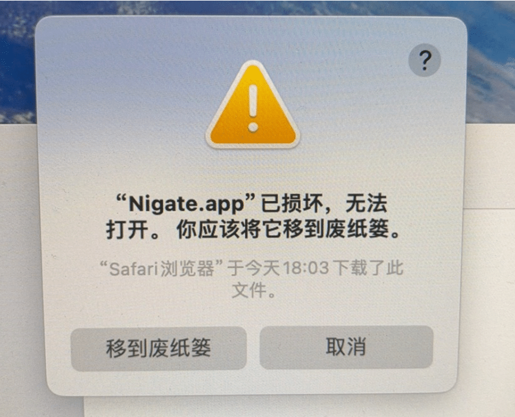

在“App” -> “终端”使用该指令解除：`xattr -cr /Applications/nigate.app`


如图操作

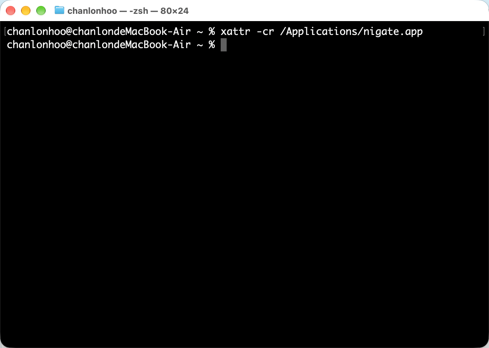

### 允许任何来源

全局关闭 Gatekeeper，运行如下代码

```bash
sudo spctl --master-disable
```

出现 `Globally disabling the assessment system needs to be confirmed in System Settings.` 提示后，如图操作

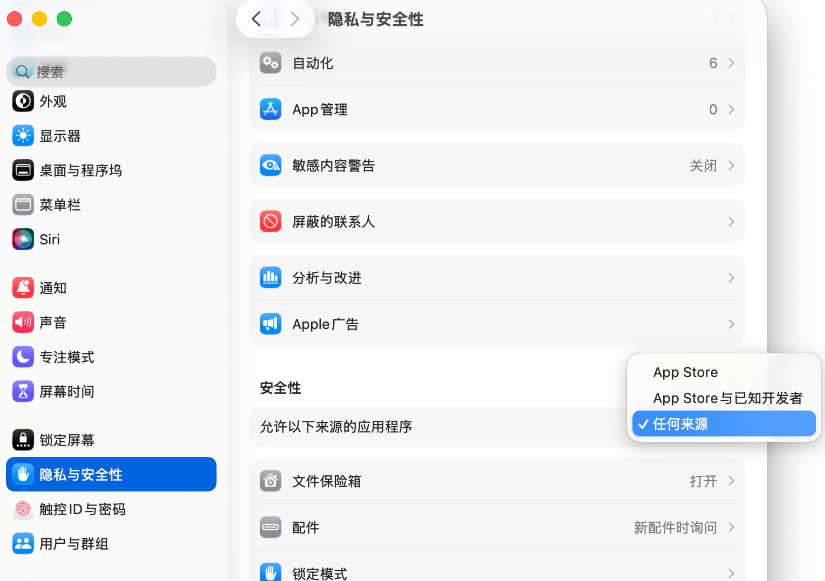

### 小结

`xattr -cr`：局部放行，精准安全，只解决眼前这个 App 的问题。（⭐⭐⭐⭐⭐ 首选）

`spctl --master-disable`：全局关闭，风险极高，相当于把 Mac 的安全大门彻底敞开。（⭐⭐⭐ 不推荐，但适合IT专业用户）

## 允许第三方内核扩展加载

出现 System Extension Blocked 弹窗时，打开系统设置的“隐私与安全性”，允许“Benjamin Fleischer”的系统扩展。

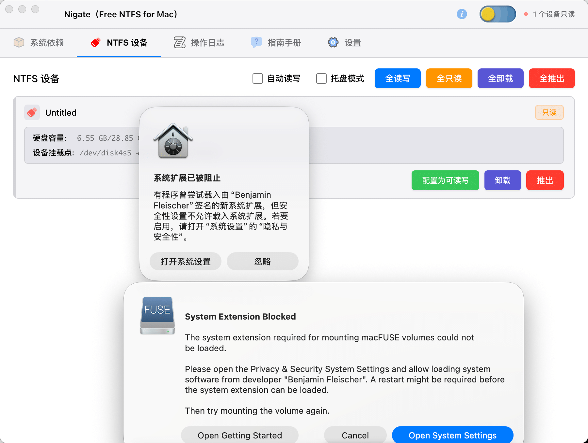

在隐私与安全性中的安全性区域点击启用系统扩展

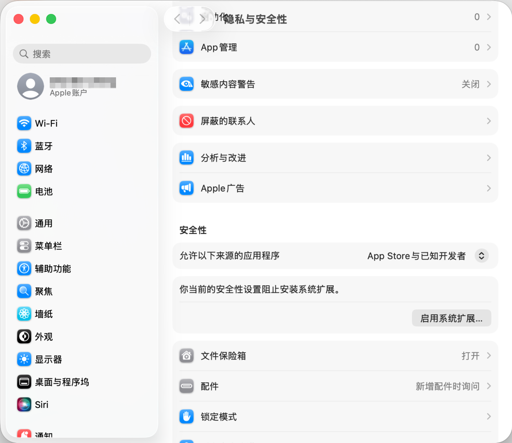

提示关机并进入恢复模式, 点击关机，接着进入到关闭SIP操作内容。

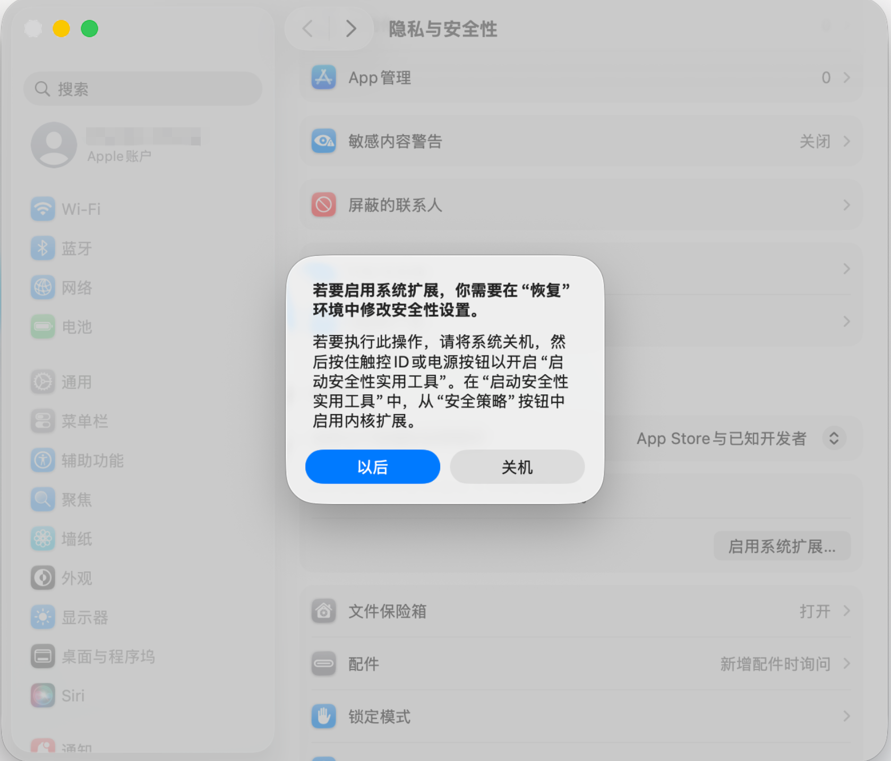

## 关闭SIP

SIP 是 System Integrity Protection 的简写，译为系统完整性保护。目的是为了限制 root 账户对系统的完全控制权，也叫 Rootless 保护机制。Mac 系统中 SIP 状态默认是开启的。 如图，该情况显然是开启的。

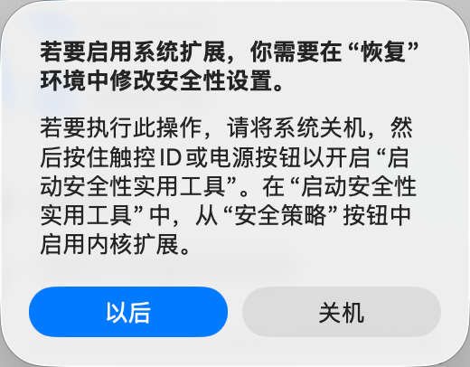

关机后，按住电源键不放，直到出现正在载入启动选项。

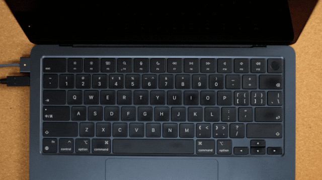

当前要继续保持按住电源按钮

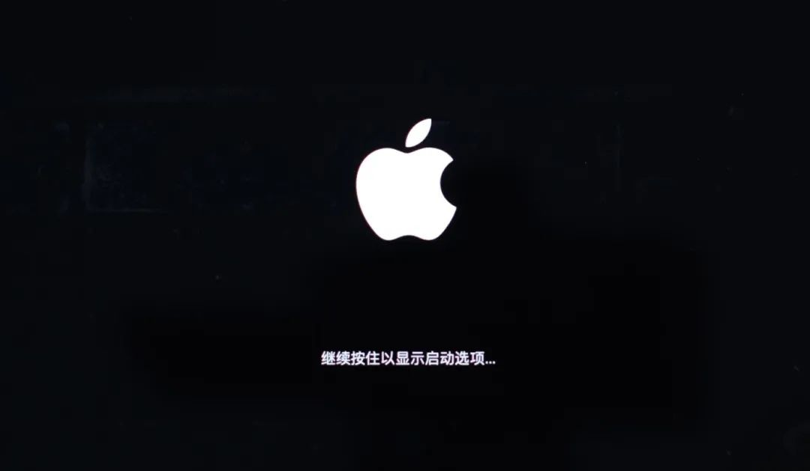

此时可以松开电源按钮了


选择账户，然后点击"下一步"，再输入Mac电脑密码。

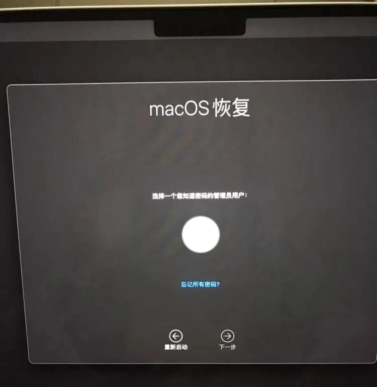

点击选项然后继续。

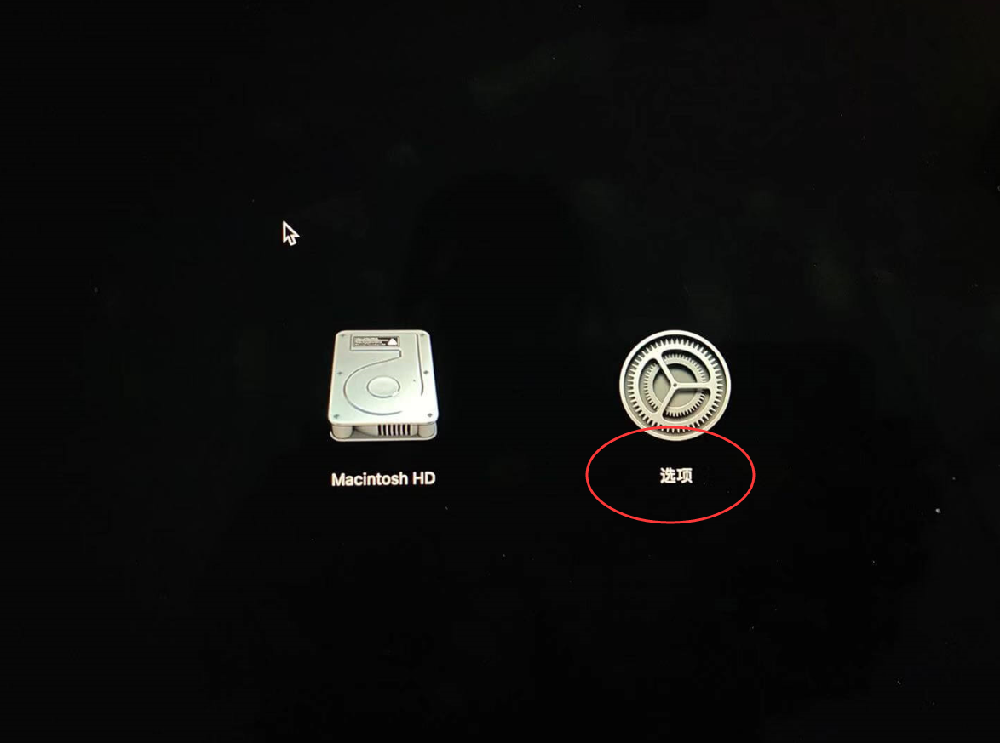

在上方菜单栏选择实用工具 -> 选择启动安全性实用工具

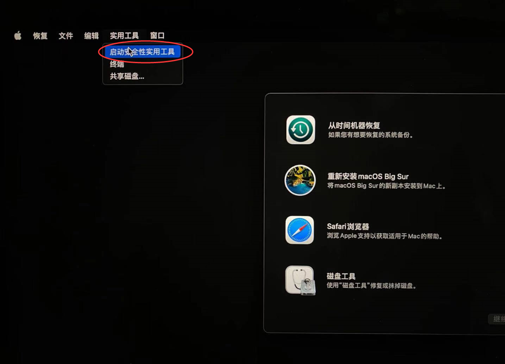

或者选择终端输入 `csrutil disable` 直接结束，重启电脑（此为，方式二）

 我们继续方式一，点击安全策略

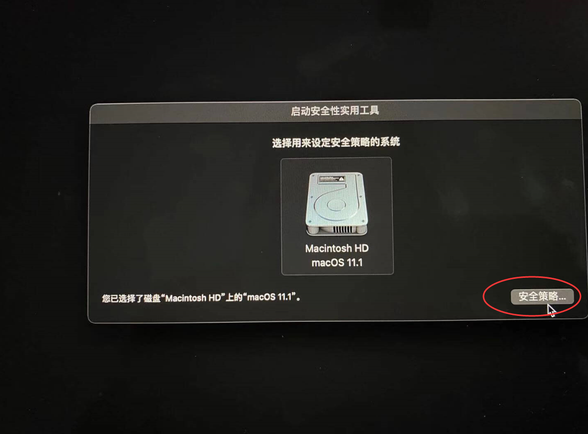

将安全策略设置为降低安全性，并勾选允许用户管理来自被认可开发者的内核扩展→ 确定。

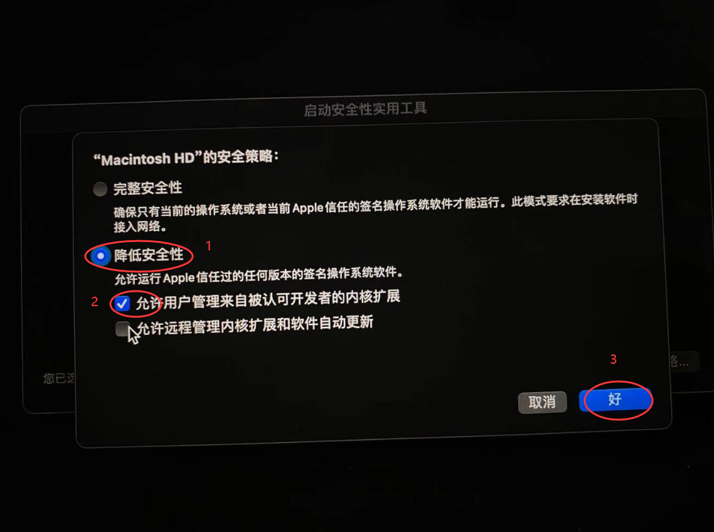

终端输入 `csrutil status` 即可看到 SIP 的状态是 disable 还是 enable 。

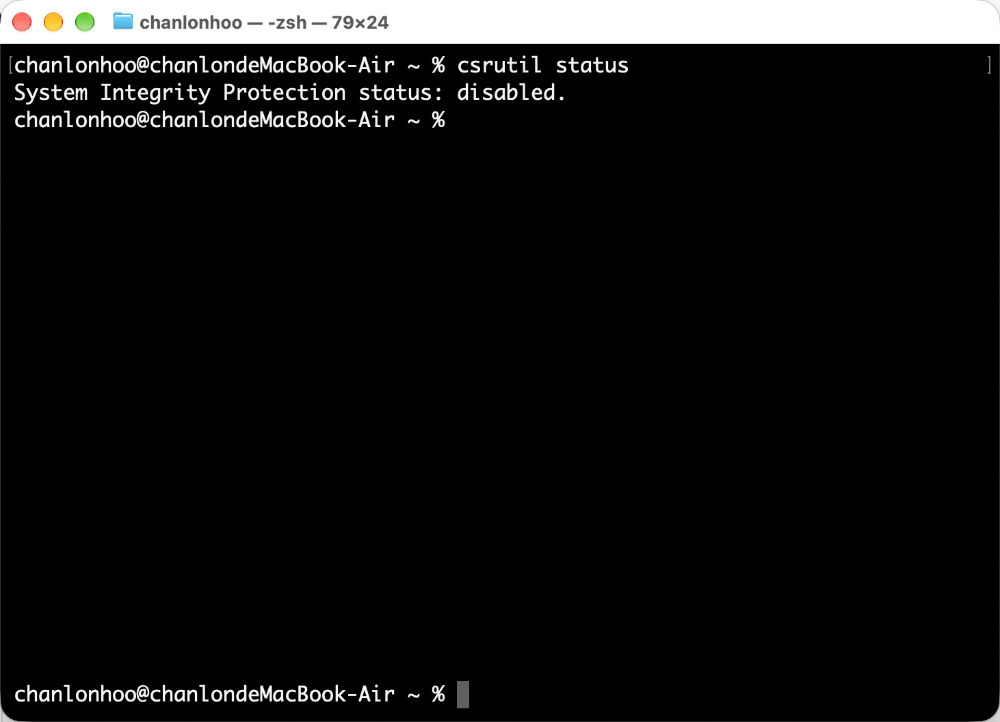

## 开启文件系统扩展

在“通用”设置中，依次选择“登录项与扩展” > “扩展” > “按类别” > “文件系统扩展”。随后点击该项对应的信息图标，或使用如下命令跳转到“文件系统扩展”，并启用 ntfs-3g（如存在）及 macFUSE 等相关选项。

```shell
open "x-apple.systempreferences:com.apple.ExtensionsPreferences?extensionPointIdentifier=com.apple.fskit.fsmodule"
```

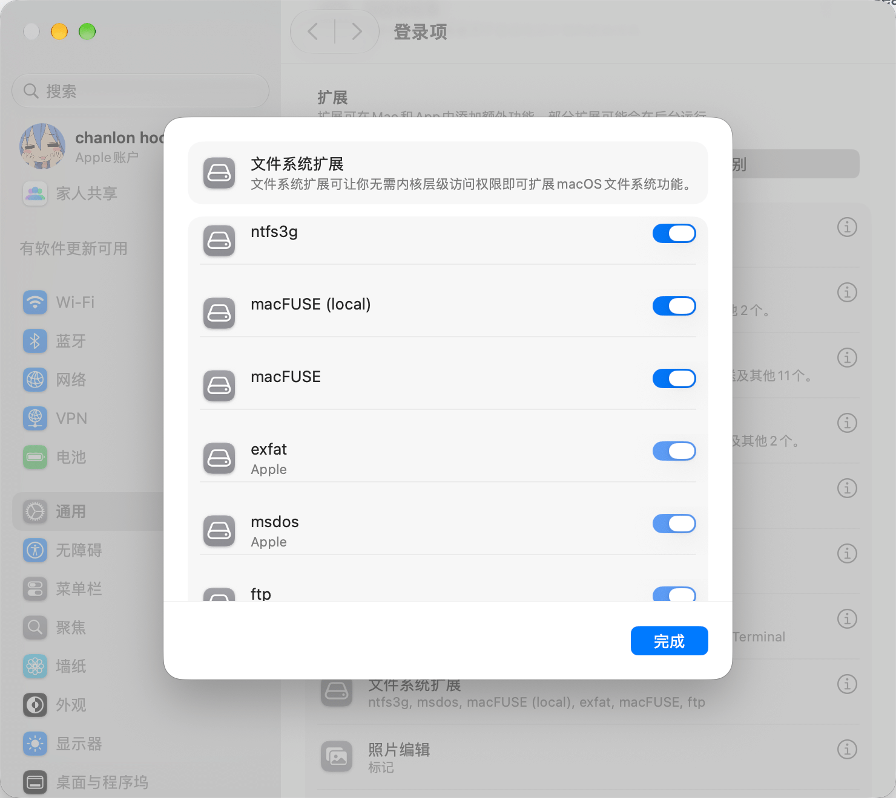