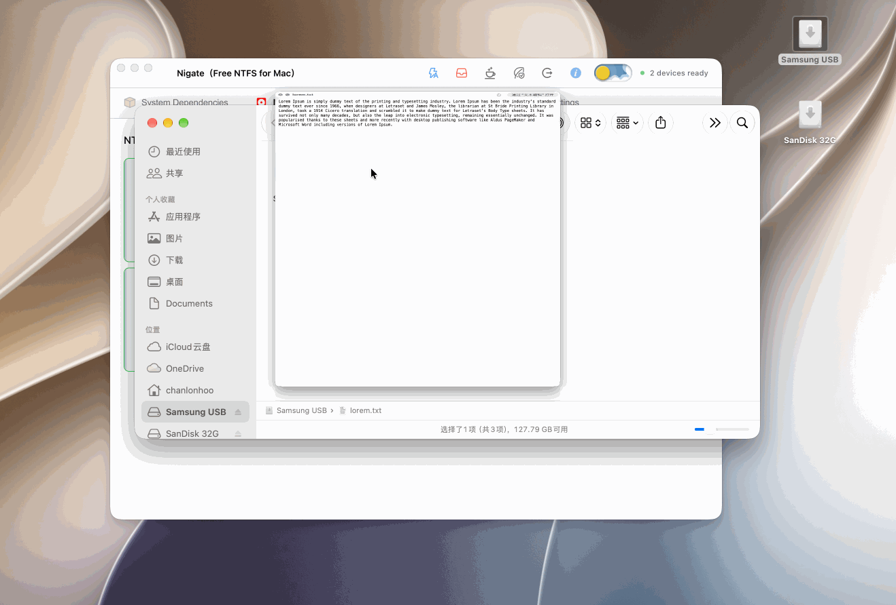

# Nigate

**Language / 言語 / 语言**: [English](README.en.md) | [日本語](README.ja.md) | [简体中文](README.md)

Nigate is a native macOS application for mounting NTFS volumes with read/write support.

Download the latest version from the [release tags](https://github.com/hoochanlon/Free-NTFS-for-Mac/tags).



The demo shows a version older than 1.6.1.

## Features

- SwiftUI app: live NTFS device detection, dependency checks, one-click mount, auto RW mount, status logs, sleep prevention, safety lock
- Multilingual UI: Simplified/Traditional Chinese, Japanese, English, German, and more
- **Dual mount backend**
  - **ntfs-3g (default / compatibility)**: MacFUSE + `ntfs-3g`; primary path for most users and unsigned builds
  - **FSKit (optional / native)**: Nigate FSKit extension with embedded NTFS engine; pick in **Settings → Mount Backend**

## Mount backends

| Backend | Needs | Notes |
| --- | --- | --- |
| ntfs-3g | MacFUSE, `ntfs-3g` | Default. Works with ad-hoc / local builds. |
| FSKit | macOS 15.4+, Nigate FSKit extension installed & enabled | Optional. No silent fallback to ntfs-3g on failure. |

Enable FSKit:

1. Build/install `Nigate.app` into `/Applications` (`./macos/Scripts/build.sh`); extension is under `Contents/Extensions`
2. **Without an Apple code-signing identity**, System Settings → File System Extensions **usually will not list Nigate** (ad-hoc builds are filtered there even if `pluginkit` already registered them)
3. Verify registration: `pluginkit -m -v -p com.apple.fskit.fsmodule | grep -i nigate`
4. With Developer ID / Development Team signing, the Settings row can appear; then set **Mount Backend** to **FSKit (Native)** in the app

Programmatic `FSClient.mountSingleVolume` needs a trusted signature with `com.apple.developer.fskit.mount`. Without a signing identity, keep **ntfs-3g** as the primary path.

## Other FSKit-based NTFS software

More apps in this category will look similar; the differences are mostly UI and workflow. Snapshot from [#68](https://github.com/hoochanlon/Free-NTFS-for-Mac/issues/68); the list is not kept exhaustive.

| Name | Price | Link |
| --- | --- | --- |
| xntfs | App Store ¥8 | https://github.com/HuanchuanTech/xntfs |
| NTFS Explorer Pro | App Store ¥68 | https://appagg.com/macos/utilities/ntfs-explorer-pro-43459914.html |
| ttntfs | Free | https://github.com/dr-kbadawi/ttntfs |
| LightNTFS Beta | Free | https://macadmin.hu/#apps |
| volisle | Free | https://github.com/qsw745/volisle |
| ntfskit | Build from source, free & open source | https://github.com/whereteam/ntfskit |

There is also a VM-passthrough approach: [anylinuxfs](https://github.com/nohajc/anylinuxfs), plus GUI wrappers [anylinuxfs-gui](https://github.com/fenio/anylinuxfs-gui) and [ntfsmac](https://github.com/khr898/ntfsmac).

## Technical comparison

From [#68](https://github.com/hoochanlon/Free-NTFS-for-Mac/issues/68). Nigate defaults to the first-generation compatibility path; FSKit (third generation) is optional on macOS 15.4+.

| | 1st gen (FUSE + NTFS-3G) | 2nd gen (commercial kext) | 3rd gen (userspace FSKit) |
| --- | --- | --- | --- |
| Speed | Lower | Very high | High (closing on 2nd gen) |
| Stability | Weaker | Very high | High (better future compatibility) |
| Safety | Medium | Medium–low (high privilege) | Very high |
| Setup | Higher (needs FUSE) | Medium (manual extension allow) | Very low (install and use) |
| macOS compatibility | Poor | Good (needs timely updates) | Excellent (Apple’s recommended model) |
| Large-file copies | Easy to interrupt | Stable | Stable |
| Examples | NTFS-3G, some free tools | Paragon, Tuxera, Chiyou NTFS | xntfs, ttntfs, Chiyou NTFS |

## Important notes

> [!important]
> Stability depends on the storage device. Prefer reliable USB media.

- Mounting needs administrator privileges.
- Windows Fast Startup or hibernation leaves NTFS inconsistent. When `ntfs-3g` sees the hibernation flag, it **forces read-only** so Windows cannot overwrite later writes with stale cache and damage the volume. **Fully shut down** Windows first (no hibernate / Fast Startup), then plug the drive into the Mac. See [#68](https://github.com/hoochanlon/Free-NTFS-for-Mac/issues/68).
- FUSE + `ntfs-3g` runs in userspace, so it is usually slower than in-kernel drivers and large copies may interrupt more easily. It is still the long-lived default because it would rather go read-only than corrupt the volume. On macOS 15.4+ you can switch to FSKit in Settings.
- Gatekeeper may block unsigned builds; allow the app in **Privacy & Security**, do not disable Gatekeeper globally.
- Format is irreversible; `ntfsfix` is not a substitute for Windows `chkdsk`.

## Run & build

**Release app**: download from [tags](https://github.com/hoochanlon/Free-NTFS-for-Mac/tags), move `Nigate.app` to Applications.

**From source** (macOS 14+, Swift 6 toolchain):

```sh
git clone https://github.com/hoochanlon/Free-NTFS-for-Mac.git
cd Free-NTFS-for-Mac
swift test
swift run Nigate
./dev.sh
```

**App bundle / DMG**:

```sh
./macos/Scripts/build.sh          # → dist/Nigate.app (ad-hoc signed)
./macos/Scripts/package-dmg.sh    # → dist/Nigate-1.6.3.dmg
```

Optional Developer ID + notarization:

```sh
DEVELOPER_ID_APPLICATION="Developer ID Application: Example" \
NOTARY_PROFILE="your-notary-profile" \
NOTARIZE=1 \
./macos/Scripts/build.sh
```

## Layout

```text
Package.swift
macos/Sources/Nigate/              App (Domain / Infra / NTFS / App / UI)
macos/Sources/NigateFSKitCore/     Shared FSKit identity & mount-backend policy
macos/Sources/NigateFSKitExtension/ FSKit data plane (appex)
macos/Sources/NigateNTFSEngine/    Static-linked NTFS engine for the extension
Tests/NigateTests/
docs/README.md
```

## Acknowledgements

If Nigate helps you, you can leave a tip:

<p align="center">
  
</p>

Thanks to everyone who contributed. See [ACKNOWLEDGMENTS.md](ACKNOWLEDGMENTS.md).
