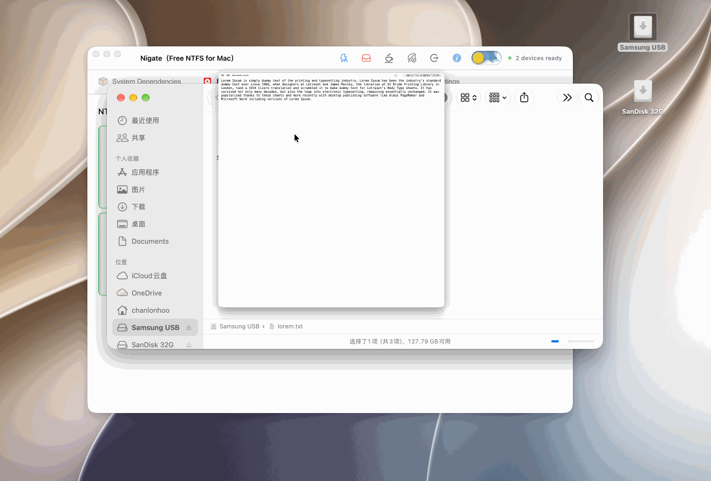

# Nigate(Free-NTFS-for-Mac)

[](https://github.com/hoochanlon/Free-NTFS-for-Mac) [](https://github.com/hoochanlon/Free-NTFS-for-Mac/blob/main/LICENSE) [](mailto:hoochanlon@outlook.com)

**言語:** [简体中文](README.md) [English](README.en.md) [日本語](README.ja.md)

**クイックスタート：** https://github.com/hoochanlon/Free-NTFS-for-Mac/tags からダウンロードして使えます。



このデモは 1.6.1 より前のバージョンのものです。

> [!WARNING]
> Intel Mac 向け注意：
> * Intel Mac では [v1.4.5](https://github.com/hoochanlon/Free-NTFS-for-Mac/releases/tag/v1.4.5) を使ってください
> * macFUSE / `ntfs-3g` を Homebrew で入れる場合、公式 bottle は **2026 年 9 月**に停止
> * **2027 年 9 月以降** Homebrew は Intel 上で動作しません
> * Intel Mac は macOS 26 が最後です。**macOS 28 は Intel には適用されません**
> * Rosetta 2 の一般向け翻訳は **macOS 27** までで、**macOS 28** 以降は通常の Intel アプリを実行しません（一部の旧ゲームのみ）。

## 機能

- SwiftUI：NTFS デバイスの自動検出、依存関係チェック、ワンクリックマウント、自動読み書き、状態ログ、スリープ防止、保護ロック
- 多言語 UI：簡体字/繁体字中国語、日本語、英語、ドイツ語など
- **デュアルマウントバックエンド**
  - **ntfs-3g（デフォルト / 互換）**：MacFUSE + `ntfs-3g`。一般利用および未署名ビルドの主経路
  - **FSKit（オプション / ネイティブ）**：NTFS エンジンを内包した Nigate FSKit 拡張。**設定 → マウントバックエンド** で切替

## マウントバックエンド

| バックエンド | 必要条件 | 説明 |
| --- | --- | --- |
| ntfs-3g | MacFUSE、`ntfs-3g` | デフォルト。ad-hoc / ローカルビルドで利用可。 |
| FSKit | macOS 15.4+、拡張のインストールと有効化 | オプション。失敗時に ntfs-3g へ**黙って降格しない**。 |

FSKit を有効にする手順：

1. `Nigate.app` を `/Applications` にビルド/インストール（`./macos/Scripts/build.sh`）。拡張は `Contents/Extensions`
2. **Apple のコード署名 ID が無い場合**、「システム設定 → ファイルシステム拡張機能」に **Nigate は通常表示されません**（ad-hoc は設定一覧でフィルタされる。`pluginkit` には登録済みのことがある）
3. 登録確認: `pluginkit -m -v -p com.apple.fskit.fsmodule | grep -i nigate`
4. Developer ID / Development Team で正式署名後、設定一覧に出る可能性あり。その後アプリで **マウントバックエンド** を **FSKit（ネイティブ）** に

`FSClient.mountSingleVolume` には `com.apple.developer.fskit.mount` 付きの信頼できる署名が必要です。署名 ID が無い場合は **ntfs-3g** を主経路にしてください。

## その他の FSKit ベース NTFS ソフト

同類ソフトは今後も増えます。違いは主に UI と使い勝手です。一覧は [#68](https://github.com/hoochanlon/Free-NTFS-for-Mac/issues/68) 時点の記録で、以後は逐一追加しません。

| 名前 | 価格 | リンク |
| --- | --- | --- |
| xntfs | App Store 8 元 | https://github.com/HuanchuanTech/xntfs |
| NTFS Explorer Pro | App Store 68 元 | https://appagg.com/macos/utilities/ntfs-explorer-pro-43459914.html |
| ttntfs | 無料 | https://github.com/dr-kbadawi/ttntfs |
| LightNTFS Beta | 無料 | https://macadmin.hu/#apps |
|mountfs| 無料 |https://github.com/guoquan/mountfs|
| 盘屿 (volisle) | 無料 | https://github.com/qsw745/volisle |
| ntfskit | ビルドが必要、無料オープンソース | https://github.com/whereteam/ntfskit |

仮想マシン経由の経路もあります。マウントの仕組みが違うので、後述の [anylinuxfs](#anylinuxfs) を見てください。

## 技術比較

[#68](https://github.com/hoochanlon/Free-NTFS-for-Mac/issues/68) より。Nigate のデフォルトは第1世代の互換経路で、macOS 15.4+ では第3世代の FSKit を選べます。

| 比較項目 | 第1世代（FUSE + NTFS-3G） | 第2世代（商用カーネル kext） | 第3世代（ユーザー空間 FSKit） |
| --- | --- | --- | --- |
| 速度 | 低め | 非常に高い | 高い（第2世代に接近中） |
| 安定性 | 弱め | 非常に高い | 高い（将来の互換性に有利） |
| 安全性 | 中 | 中低（権限が高い） | 非常に高い |
| 導入の手間 | 高め（FUSE が必要） | 中（拡張の許可が必要） | 非常に低い（入れてすぐ使える） |
| macOS 互換性 | 悪い | 良好（都度の対応が必要） | 優秀（Apple 推奨アーキテクチャ） |
| 大容量ファイル転送 | 切れやすい | 安定 | 安定 |
| 代表例 | NTFS-3G、一部の無料ソフト | Paragon、Tuxera、赤友 NTFS | xntfs、ttntfs、赤友 NTFS |

## 注意事項

> [!important]
> 安定性はストレージ性能に依存します。信頼性の高い USB メディアを使用してください。

> [!important]
> 安定した Developer ID がない場合、Touch ID で権限昇格すべきではありません。
>
> Touch ID は「この Mac の持ち主本人」であることしか証明できず、管理者パスワードは取り出せません。マウント、修復、フォーマットは `sudo -S` 経由であり、平文のパスワードが必要です。
>
> よくあるつなぎ方も不安定です：
> - システムの認可ダイアログ：成功しても「認可済み」印だけで、パスワードはなく `sudo -S` に渡せない
> - Touch ID で読むキーチェーンにパスワードを置く：再びディスクへ永続化することになり、開発者署名がないと再ビルドや更新後にアプリ識別がずれ、またダイアログが出る
> - 特権ヘルパー：ヘルパーの識別も署名に縛られるため、ad-hoc ビルドのたびに再認可が必要
>
> いまは「終了するまでパスワードを記憶」（メモリのみ、終了で消える）がこの経路では最も安定です。安定した署名が付いてから、システム認可または特権ヘルパーへ移すのがよく、そのとき Touch ID はアプリが模倣するものではなく、システムの機能になります。

- マウントには管理者権限が必要です。
- Windows の高速スタートアップや休止状態は、NTFS を未完了のまま残します。`ntfs-3g` が休止フラグを検出すると**強制的に読み取り専用**になり、Windows 復帰時の古いキャッシュで書き込みが上書きされてボリュームが壊れるのを防ぎます。先に Windows を**完全シャットダウン**し（休止 / 高速スタートアップは使わない）、その後 Mac に接続してください。説明は [#68](https://github.com/hoochanlon/Free-NTFS-for-Mac/issues/68)。
- FUSE + `ntfs-3g` はユーザー空間経由のため、カーネルドライバより遅く、大きなファイル転送も切れやすいことがあります。長期的に使われているのは、読み取り専用になってもボリュームを壊さない方針だからです。macOS 15.4+ では設定から FSKit に切り替えできます。
- 未署名ビルドは Gatekeeper にブロックされる場合があります。**プライバシーとセキュリティ**で個別に許可し、Gatekeeper を全体無効にしないでください。
- フォーマットは不可逆です。`ntfsfix` は Windows の `chkdsk` の代替ではありません。

## APFS の基礎

[#77](https://github.com/hoochanlon/Free-NTFS-for-Mac/issues/77) のように、Mac の Nigate に出ないディスクが Windows（Parallels 上の Windows を含む）では開ける、という報告は、マウント失敗ではなく**フォーマットの取り違え**であることが多いです。Nigate が扱うのは NTFS だけです。Mac 側の既定ファイルシステムは APFS です。

**APFS（Apple File System）** は macOS High Sierra（2017）以降、Apple 製デバイスの既定形式で、iOS / iPadOS でも使われます。NTFS との役割分担：

| | APFS | NTFS |
| --- | --- | --- |
| 設計 | Apple | Microsoft |
| よくある場所 | Mac、Apple 製デバイス、Time Machine | Windows、「Windows と Mac 両用」の外付けディスク |
| macOS | 標準で読み書き | 標準はほぼ読み取り専用。書き込みに Nigate が必要 |
| Windows | 標準では認識しない | 標準で読み書き |

APFS は「ディスク 1 台 = パーティション 1 つ」ではありません。

- **コンテナ（Container）**：1 つのパーティションで、中のボリュームが**空き領域を共有**する
- **ボリューム（Volume）**：システム、データ、Preboot などが同じコンテナに入れる。外付けではユーザーボリュームが 1 つに見えることが多い
- **スナップショット / クローン**：内容が変わるまでコピーはほとんど容量を使わない（copy-on-write）
- 「ディスクユーティリティ」で外付けを消去すると、方式が **APFS** のままになりやすい。Finder では普通の USB メモリのように開けるが、Nigate の一覧には出ない

確認方法：

1. 「ディスクユーティリティ」でボリュームを選び、形式が APFS / APFS（暗号化）か、NTFS / ExFAT かを見る
2. ターミナル：`diskutil info diskXsY`。`File System Personality` が `APFS` なら Nigate の対象ではない
3. Windows と Mac の**両方で書きたい**外付けなら **ExFAT**（どちらも標準）、または **NTFS** にして Mac では Nigate を使う

Nigate は **APFS をマウントしません**。Mac が APFS を読み書きするのに本アプリは不要です。

### Windows で APFS を開く

逆方向：Mac で APFS にした USB を Windows に挿すと、エクスプローラーには何も出ないことが多いです。オープンソースの手段：[APFS Explorer](https://github.com/enesilhaydin/apfs-explorer)（GPL-3.0）。

- [WinFsp](https://winfsp.dev/) 経由で Windows 10/11 に APFS ボリュームをドライブレターとしてマウント
- [Releases](https://github.com/enesilhaydin/apfs-explorer/releases) から `apfs-explorer-setup.exe` を管理者として実行。インストーラが WinFsp を同梱しようとする
- **既定は読み取り専用**。書き込みはまだ実験的で、ボリュームを壊す可能性がある。バックアップを取り、唯一のコピーにしない
- FileVault、密封システムボリューム、Fusion Drive は対象外

Nigate の鏡像です。Nigate は Mac で NTFS を書くため、APFS Explorer は Windows で APFS を読むためです。

## anylinuxfs

[anylinuxfs/issues/86](https://github.com/nohajc/anylinuxfs/issues/86) で既に書いてあるとおり、これは Nigate と**同じマウント経路ではない**ので、Nigate のデバイスカードには取り込みません。

[anylinuxfs](https://github.com/nohajc/anylinuxfs) は **Apple Silicon** 上で [libkrun](https://github.com/containers/libkrun) のマイクロ VM と NFS を使い、Linux が扱えるファイルシステムを macOS に渡します。カーネル拡張は不要で、SIP も下げません。

データの流れ：

```text
物理パーティション / ディスクイメージ
        ↓ Linux マイクロ VM に渡す（本物の Linux ドライバ）
VM 内で ext4 / btrfs / xfs / NTFS / … をマウント
        ↓ NFS で localhost に公開
macOS から見えるのはネットワークディスク（NFS / WebDAV に近い）
        /dev/disk のようなローカルボリュームではない
```

Nigate が見ているのは DiskArbitration とローカルのマウント表で、カード 1 枚がローカル NTFS 1 つです。anylinuxfs のマウント点はネットワークパスに近く、一覧・ビジー状態・読み取り専用↔読み書きの切替が噛み合わないため、GUI で包めません。別 UI は [anylinuxfs-gui](https://github.com/fenio/anylinuxfs-gui)、[ntfsmac](https://github.com/khr898/ntfsmac)。

向いている用途：

- Mac で **ext4 / btrfs / xfs / ZFS** を読み書きする。LVM、Linux RAID、LUKS、BitLocker（NTFS / FAT32）も含む
- 外付け、内蔵、raw / qcow2 イメージ
- 複数ドライブの同時マウント（ボリュームごとにマイクロ VM。メモリ上限の既定は 512 MB、実使用は約 256 MB）

制限：

- **Apple Silicon のみ**
- Finder ではネットワークディスク。Microsoft Word はその上のファイルを直接編集できない
- VM 内の既定 NTFS ドライバは `ntfs-3g`。大量ファイルの長時間コピーで I/O エラーが出ることがある（`-t ntfs3` に切り替え可。[NTFS の注記](https://github.com/nohajc/anylinuxfs/blob/main/docs/important-notes.md#ntfs)）
- 休止ディスクやダーティボリュームは Linux 側ドライバの話で、Nigate のホスト上 NTFS 経路の代替にはならない

インストール：

```sh
brew tap nohajc/anylinuxfs
brew trust nohajc/anylinuxfs
brew install anylinuxfs
```

よく使う操作：`anylinuxfs list`、`anylinuxfs mount /dev/diskXsY`。Finder で取り出すか `anylinuxfs unmount`。

## 実行とビルド

**リリース版**：[タグ](https://github.com/hoochanlon/Free-NTFS-for-Mac/tags) から取得し、`Nigate.app` を「アプリケーション」へ移動。

**ソースから**（macOS 14+、Swift 6 ツールチェーン）：

```sh
git clone https://github.com/hoochanlon/Free-NTFS-for-Mac.git
cd Free-NTFS-for-Mac
swift test
swift run Nigate
./dev.sh
```

**アプリバンドル / DMG**：

```sh
./macos/Scripts/build.sh          # → dist/Nigate.app（ad-hoc 署名）
./macos/Scripts/package-dmg.sh    # → dist/Nigate-<version>.dmg
```

任意の Developer ID + 公証：

```sh
DEVELOPER_ID_APPLICATION="Developer ID Application: Example" \
NOTARY_PROFILE="your-notary-profile" \
NOTARIZE=1 \
./macos/Scripts/build.sh
```

## コマンドラインスクリプト（ninja）

`ninja/` は Nigate.app とは別系統のターミナル用ツールで、Swift アプリは経由しません。ワンライナーは [ninja/README.md](ninja/README.md) を参照。

| スクリプト | 役割 |
| --- | --- |
| `nigate.sh` | NTFS デバイスを監視し、読み取り専用から読み書きへ掛け直す |
| `kamui.sh` | Linux ファイルシステム（ext2/3/4、btrfs、xfs、zfs など）をマウント |
| `kunai.sh` | MacFUSE、ntfs-3g などの依存関係を入れる |
| `ninpo.sh` | 上記の依存関係を外す（Xcode Command Line Tools は残す） |
| `shuriken.sh` | システム権限の設定（Gatekeeper、SIP など） |

`kamui-lang.sh` と `shuriken-lang.sh` は対応スクリプトの文言ファイルです。単体では実行しないでください。

## 構成

```text
Package.swift
macos/Sources/Nigate/              メインアプリ（Domain / Infra / NTFS / App / UI）
macos/Sources/NigateFSKitCore/     FSKit 識別子とマウントバックエンド方針
macos/Sources/NigateFSKitExtension/ FSKit データプレーン（appex）
macos/Sources/NigateNTFSEngine/    拡張向け静的リンク NTFS エンジン
Tests/NigateTests/
ninja/                             コマンドラインスクリプト（アプリとは独立）
docs/README.md
```

## 謝辞

Nigate が役に立ったら、チップで応援できます：

<p align="center">
  
</p>

ボランティアの皆さまに感謝します。詳細は [ACKNOWLEDGMENTS.md](ACKNOWLEDGMENTS.md)。
