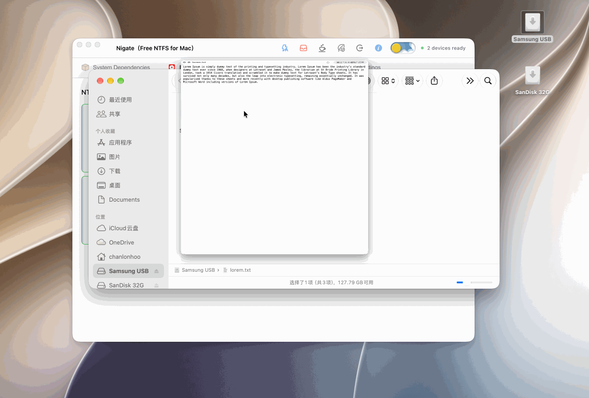

# Nigate

**言語 / Language / 语言**: [日本語](README.ja.md) | [English](README.en.md) | [简体中文](README.md)

Nigate は、NTFS ボリュームを読み書き可能な状態でマウントするための、macOS ネイティブアプリケーションです。

最新版は [リリースタグ](https://github.com/hoochanlon/Free-NTFS-for-Mac/tags) からダウンロードできます。



このデモは 1.6.1 より前のバージョンのものです。

## 機能

- SwiftUI：NTFS デバイスの自動検出、依存関係チェック、ワンクリックマウント、自動読み書き、状態ログ、スリープ防止、保護ロック
- 多言語 UI：簡体字/繁体字中国語、日本語、英語、ドイツ語など
- **デュアルマウントバックエンド**
  - **ntfs-3g（デフォルト / 互換）**：MacFUSE + `ntfs-3g`。一般利用および未署名ビルドの主経路
  - **FSKit（オプション / ネイティブ）**：NTFS エンジンを内包した Nigate FSKit 拡張。**設定 → マウントバックエンド** で切替

## マウントバックエンド

| バックエンド | 必要条件 | 説明 |
| --- | --- | --- |
| ntfs-3g | MacFUSE、`ntfs-3g` | デフォルト。ad-hoc / ローカルビルドで利用可。 |
| FSKit | macOS 15.4+、拡張のインストールと有効化 | オプション。失敗時に ntfs-3g へ**黙って降格しない**。 |

FSKit を有効にする手順：

1. `Nigate.app` を `/Applications` にビルド/インストール（`./macos/Scripts/build.sh`）。拡張は `Contents/Extensions`
2. **Apple のコード署名 ID が無い場合**、「システム設定 → ファイルシステム拡張機能」に **Nigate は通常表示されません**（ad-hoc は設定一覧でフィルタされる。`pluginkit` には登録済みのことがある）
3. 登録確認: `pluginkit -m -v -p com.apple.fskit.fsmodule | grep -i nigate`
4. Developer ID / Development Team で正式署名後、設定一覧に出る可能性あり。その後アプリで **マウントバックエンド** を **FSKit（ネイティブ）** に

`FSClient.mountSingleVolume` には `com.apple.developer.fskit.mount` 付きの信頼できる署名が必要です。署名 ID が無い場合は **ntfs-3g** を主経路にしてください。

## その他の FSKit ベース NTFS ソフト

同類ソフトは今後も増えます。違いは主に UI と使い勝手です。一覧は [#68](https://github.com/hoochanlon/Free-NTFS-for-Mac/issues/68) 時点の記録で、以後は逐一追加しません。

| 名前 | 価格 | リンク |
| --- | --- | --- |
| xntfs | App Store 8 元 | https://github.com/HuanchuanTech/xntfs |
| NTFS Explorer Pro | App Store 68 元 | https://appagg.com/macos/utilities/ntfs-explorer-pro-43459914.html |
| ttntfs | 無料 | https://github.com/dr-kbadawi/ttntfs |
| LightNTFS Beta | 無料 | https://macadmin.hu/#apps |
| 盘屿 (volisle) | 無料 | https://github.com/qsw745/volisle |
| ntfskit | ビルドが必要、無料オープンソース | https://github.com/whereteam/ntfskit |

仮想マシン経由の経路もあります：[anylinuxfs](https://github.com/nohajc/anylinuxfs)、および GUI 版の [anylinuxfs-gui](https://github.com/fenio/anylinuxfs-gui)、[ntfsmac](https://github.com/khr898/ntfsmac)。

## 技術比較

[#68](https://github.com/hoochanlon/Free-NTFS-for-Mac/issues/68) より。Nigate のデフォルトは第1世代の互換経路で、macOS 15.4+ では第3世代の FSKit を選べます。

| 比較項目 | 第1世代（FUSE + NTFS-3G） | 第2世代（商用カーネル kext） | 第3世代（ユーザー空間 FSKit） |
| --- | --- | --- | --- |
| 速度 | 低め | 非常に高い | 高い（第2世代に接近中） |
| 安定性 | 弱め | 非常に高い | 高い（将来の互換性に有利） |
| 安全性 | 中 | 中低（権限が高い） | 非常に高い |
| 導入の手間 | 高め（FUSE が必要） | 中（拡張の許可が必要） | 非常に低い（入れてすぐ使える） |
| macOS 互換性 | 悪い | 良好（都度の対応が必要） | 優秀（Apple 推奨アーキテクチャ） |
| 大容量ファイル転送 | 切れやすい | 安定 | 安定 |
| 代表例 | NTFS-3G、一部の無料ソフト | Paragon、Tuxera、赤友 NTFS | xntfs、ttntfs、赤友 NTFS |

## 注意事項

> [!important]
> 安定性はストレージ性能に依存します。信頼性の高い USB メディアを使用してください。

- マウントには管理者権限が必要です。
- Windows の高速スタートアップや休止状態は、NTFS を未完了のまま残します。`ntfs-3g` が休止フラグを検出すると**強制的に読み取り専用**になり、Windows 復帰時の古いキャッシュで書き込みが上書きされてボリュームが壊れるのを防ぎます。先に Windows を**完全シャットダウン**し（休止 / 高速スタートアップは使わない）、その後 Mac に接続してください。説明は [#68](https://github.com/hoochanlon/Free-NTFS-for-Mac/issues/68)。
- FUSE + `ntfs-3g` はユーザー空間経由のため、カーネルドライバより遅く、大きなファイル転送も切れやすいことがあります。長期的に使われているのは、読み取り専用になってもボリュームを壊さない方針だからです。macOS 15.4+ では設定から FSKit に切り替えできます。
- 未署名ビルドは Gatekeeper にブロックされる場合があります。**プライバシーとセキュリティ**で個別に許可し、Gatekeeper を全体無効にしないでください。
- フォーマットは不可逆です。`ntfsfix` は Windows の `chkdsk` の代替ではありません。

## 実行とビルド

**リリース版**：[タグ](https://github.com/hoochanlon/Free-NTFS-for-Mac/tags) から取得し、`Nigate.app` を「アプリケーション」へ移動。

**ソースから**（macOS 14+、Swift 6 ツールチェーン）：

```sh
git clone https://github.com/hoochanlon/Free-NTFS-for-Mac.git
cd Free-NTFS-for-Mac
swift test
swift run Nigate
./dev.sh
```

**アプリバンドル / DMG**：

```sh
./macos/Scripts/build.sh          # → dist/Nigate.app（ad-hoc 署名）
./macos/Scripts/package-dmg.sh    # → dist/Nigate-1.6.3.dmg
```

任意の Developer ID + 公証：

```sh
DEVELOPER_ID_APPLICATION="Developer ID Application: Example" \
NOTARY_PROFILE="your-notary-profile" \
NOTARIZE=1 \
./macos/Scripts/build.sh
```

## 構成

```text
Package.swift
macos/Sources/Nigate/              メインアプリ（Domain / Infra / NTFS / App / UI）
macos/Sources/NigateFSKitCore/     FSKit 識別子とマウントバックエンド方針
macos/Sources/NigateFSKitExtension/ FSKit データプレーン（appex）
macos/Sources/NigateNTFSEngine/    拡張向け静的リンク NTFS エンジン
Tests/NigateTests/
docs/README.md
```

## 謝辞

Nigate が役に立ったら、チップで応援できます：

<p align="center">
  
</p>

貢献者の皆さまに感謝します。詳細は [ACKNOWLEDGMENTS.md](ACKNOWLEDGMENTS.md)。
