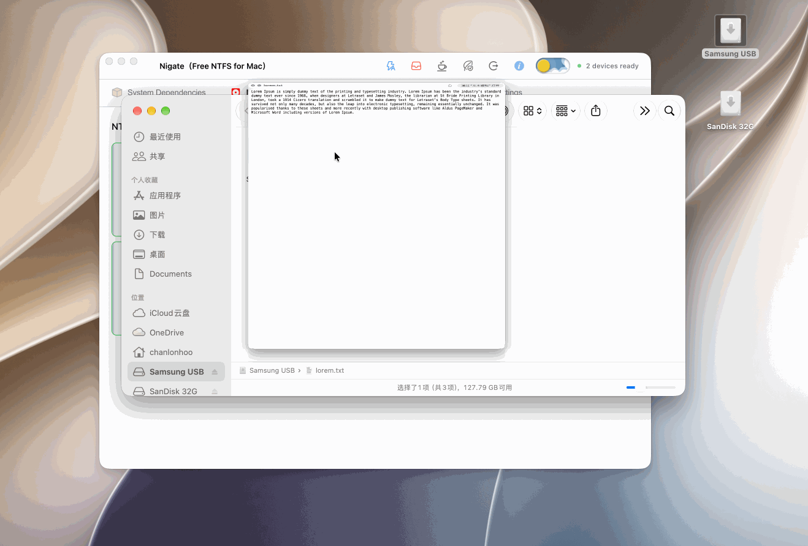

# Nigate

**语言 / Language / 言語**: [简体中文](README.md) | [English](README.en.md) | [日本語](README.ja.md)

快速开始：从 [发布标签](https://github.com/hoochanlon/Free-NTFS-for-Mac/tags) 下载并使用。



演示界面为 1.6.1 以下版本，界面随功能增强可能略有变化。

## 功能

- SwiftUI：实时检测 NTFS 设备、依赖检查、一键挂载、自动读写、状态日志、防止休眠、安全保护锁
- 多语言界面：简体/繁体中文、日语、英语、德语等
- **双挂载后端**
  - **ntfs-3g（默认 / 兼容）**：MacFUSE + `ntfs-3g`，面向大多数用户与未签名构建的主路径
  - **FSKit（可选 / 原生）**：内嵌 NTFS 引擎的 Nigate FSKit 扩展；在 **设置 → 挂载后端** 中切换

## 挂载后端

| 后端 | 条件 | 说明 |
| --- | --- | --- |
| ntfs-3g | MacFUSE、`ntfs-3g` | 默认。ad-hoc / 本地构建可用。 |
| FSKit | macOS 15.4+，扩展已安装并启用 | 可选。失败时**不会**静默降级到 ntfs-3g。 |

启用 FSKit：

1. 构建并安装 `Nigate.app` 到 `/Applications`（`./macos/Scripts/build.sh`），扩展位于 `Contents/Extensions`
2. **无 Apple 代码签名证书时**，「系统设置 → 文件系统扩展」**通常不会列出 Nigate**（ad-hoc 会被设置页过滤；`pluginkit` 仍可能已注册）
3. 确认注册：`pluginkit -m -v -p com.apple.fskit.fsmodule | grep -i nigate`
4. 具备 Developer ID / Development Team 正式签名后，设置页才可能出现并可启用；应用内再将 **挂载后端** 设为 **FSKit（原生）**

程序化 `FSClient.mountSingleVolume` 需要带 `com.apple.developer.fskit.mount` 的可信签名。无签名身份时，请继续以 **ntfs-3g** 为主路径。

## 其他基于 FSKit 的 NTFS 软件

同类软件会越来越多，差别主要在 UI 和体验。清单整理自 [#68](https://github.com/hoochanlon/Free-NTFS-for-Mac/issues/68)，后续不再逐一录入。

| 名称 | 价格 | 链接 |
| --- | --- | --- |
| xntfs | App Store 8 元 | https://github.com/HuanchuanTech/xntfs |
| NTFS Explorer Pro | App Store 68 元 | https://appagg.com/macos/utilities/ntfs-explorer-pro-43459914.html |
| ttntfs | 免费 | https://github.com/dr-kbadawi/ttntfs |
| LightNTFS Beta | 免费 | https://macadmin.hu/#apps |
| 盘屿 (volisle) | 免费 | https://github.com/qsw745/volisle |
| ntfskit | 需编译，免费开源 | https://github.com/whereteam/ntfskit |

另有一条虚拟机中转路径，机制不同，见下文 [anylinuxfs](#anylinuxfs)。

## 技术对比

整理自 [#68](https://github.com/hoochanlon/Free-NTFS-for-Mac/issues/68)。Nigate 默认走第一代兼容路径，macOS 15.4+ 可选用第三代 FSKit。

| 对比维度 | 第一代（FUSE + NTFS-3G） | 第二代（商用内核驱动 kext） | 第三代（用户态 FSKit） |
| --- | --- | --- | --- |
| 性能速度 | 较低 | 极高 | 高（接近第二代，差距持续缩小） |
| 稳定性 | 较差 | 极高 | 高（未来兼容性更优） |
| 安全性 | 中等 | 中低（权限过高） | 极高 |
| 安装门槛 | 较高（需安装 FUSE） | 中等（需手动允许扩展） | 极低（即装即用） |
| macOS 兼容性 | 差 | 良好（需及时适配） | 优秀（苹果推荐架构） |
| 大文件传输 | 易中断 | 稳定 | 稳定 |
| 代表软件 / 技术 | NTFS-3G、部分免费软件 | Paragon、Tuxera、赤友 NTFS 助手 | xntfs、ttntfs、赤友 NTFS 助手 |

## 重要说明

> [!important]
> 稳定性取决于存储设备，请使用可靠的 USB 介质。

- 挂载需要管理员权限。
- Windows 快速启动或休眠会把 NTFS 留在未完成状态。`ntfs-3g` 检测到休眠标记后会**强制只读**，避免 Windows 恢复时用过时缓存覆盖写入、损坏分区。请先在 Windows 上**完全关机**（不要休眠 / 快速启动），再接入 Mac。说明见 [#68](https://github.com/hoochanlon/Free-NTFS-for-Mac/issues/68)。
- FUSE + `ntfs-3g` 走用户态，读写通常慢于内核方案，大文件也可能更容易中断；它被长期使用，主要是宁可只读、也不把卷写坏。默认后端走这条兼容路径；macOS 15.4+ 可在设置中改用 FSKit。
- 未签名应用可能被 Gatekeeper 拦截，请在 **隐私与安全性** 中按应用放行，勿全局关闭 Gatekeeper。
- 格式化不可逆；`ntfsfix` 不能替代 Windows `chkdsk`。

## APFS 基础知识

[#77](https://github.com/hoochanlon/Free-NTFS-for-Mac/issues/77) 这类反馈里，设备在 Mac 上进不了 Nigate、在 Windows（含 Parallels 里的 Windows）却能打开，先看**格式**，不要先当成挂载失败。Nigate 只处理 NTFS；Mac 自己的默认文件系统是 APFS。

**APFS（Apple File System）** 从 macOS High Sierra（2017）起就是苹果设备的默认格式，也用于 iOS / iPadOS。和 NTFS 的分工：

| | APFS | NTFS |
| --- | --- | --- |
| 谁设计的 | Apple | Microsoft |
| 默认出现在 | Mac、苹果设备、Time Machine | Windows、多数「Windows / Mac 两用」移动硬盘 |
| macOS | 系统原生读写 | 原生多为只读；要写才需要 Nigate |
| Windows | 不能原生识别 | 系统原生读写 |

APFS 不是「一块盘一个分区」那么简单：

- **容器（Container）**：占一整段分区，里面的卷**共用剩余空间**
- **卷（Volume）**：系统、数据、预启动等可以同住一个容器；外置盘上往往只看到一个用户卷
- **快照 / 克隆**：拷贝几乎不占空间，直到内容被改写（copy-on-write）
- 「磁盘工具」抹掉外置盘时，方案经常默认成 **APFS**。Finder 能打开、卷名也像普通 U 盘，但 Nigate 的设备列表不会出现它

怎么确认：

1. 「磁盘工具」选中卷，看格式是 APFS / APFS（加密），还是 NTFS / ExFAT
2. 终端：`diskutil info diskXsY`，`File System Personality` 为 `APFS` 就不是 Nigate 的目标
3. 若这块盘要在 Windows 和 Mac **都写**：外置盘用 **ExFAT**（两边原生）；或格式化为 **NTFS**，Mac 上再用 Nigate 写

Nigate **不会挂载 APFS**。Mac 读写 APFS 不需要本应用。

### 在 Windows 上打开 APFS

反过来：Mac 格式化的 APFS U 盘插到 Windows，资源管理器通常什么也看不到。开源方案：[APFS Explorer](https://github.com/enesilhaydin/apfs-explorer)（GPL-3.0）。

- 通过 [WinFsp](https://winfsp.dev/) 在 Windows 10/11 把 APFS 卷挂成盘符
- 从 [Releases](https://github.com/enesilhaydin/apfs-explorer/releases) 下载 `apfs-explorer-setup.exe`，管理员运行；安装包会尝试附带 WinFsp
- **默认只读**。写支持仍是实验性，可能损坏卷；重要数据先备份，不要把它当成唯一副本
- 不支持 FileVault 加密卷、密封系统卷、Fusion Drive

和 Nigate 是镜像关系：Nigate 让 Mac 写 NTFS；APFS Explorer 让 Windows 读 APFS。

## anylinuxfs

[anylinuxfs/issues/86](https://github.com/nohajc/anylinuxfs/issues/86) 写过：它和 Nigate **不是同一条挂载路径**，所以不会并进 Nigate 的设备卡片。

[anylinuxfs](https://github.com/nohajc/anylinuxfs) 在 **Apple Silicon** 上用 [libkrun](https://github.com/containers/libkrun) 微型虚拟机 + NFS，把 Linux 能挂的文件系统转给 macOS。不装内核扩展，也不用降低 SIP。

数据走法：

```text
物理分区 / 磁盘映像
        ↓ 交给 Linux 微虚拟机（用真实 Linux 驱动）
虚拟机里挂上 ext4 / btrfs / xfs / NTFS / …
        ↓ NFS 导出到本机
macOS 看到的是 localhost 网络盘（像 NFS / WebDAV）
        不是 /dev/disk 那种本地宗卷
```

Nigate 认的是 DiskArbitration 和本地挂载表：一张卡对应一块本地 NTFS。anylinuxfs 的挂载点更像网络路径，列表、忙状态、只读↔读写切换都对不上，GUI 不能直接包它。独立界面见 [anylinuxfs-gui](https://github.com/fenio/anylinuxfs-gui)、[ntfsmac](https://github.com/khr898/ntfsmac)。

适合：

- 在 Mac 上读写 **ext4 / btrfs / xfs / ZFS**，以及 LVM、Linux RAID、LUKS、BitLocker（NTFS / FAT32）
- 外置盘、内置盘、raw / qcow2 映像
- 多盘可以同时挂（每挂一个卷会起一台微虚拟机；默认内存上限 512 MB，实际大约 256 MB）

限制：

- **仅 Apple Silicon**
- Finder 里是网络磁盘；Microsoft Word 不能直接在上面改文件
- 默认用虚拟机里的 `ntfs-3g` 跑 NTFS，长时间拷大量文件可能出现 I/O 错误（可改 `-t ntfs3`，说明见其 [NTFS 备注](https://github.com/nohajc/anylinuxfs/blob/main/docs/important-notes.md#ntfs)）
- 休眠盘、脏卷等仍由 Linux 侧驱动处理，不能替代 Nigate 在本机这条 NTFS 路径

安装：

```sh
brew tap nohajc/anylinuxfs
brew trust nohajc/anylinuxfs
brew install anylinuxfs
```

常用：`anylinuxfs list`、`anylinuxfs mount /dev/diskXsY`；在 Finder 推出，或 `anylinuxfs unmount`。

## 运行与构建

**发布版**：从 [标签](https://github.com/hoochanlon/Free-NTFS-for-Mac/tags) 下载，将 `Nigate.app` 移入「应用程序」。

**源码运行**（macOS 14+，Swift 6 工具链）：

```sh
git clone https://github.com/hoochanlon/Free-NTFS-for-Mac.git
cd Free-NTFS-for-Mac
swift test
swift run Nigate
./dev.sh
```

**应用包 / DMG**：

```sh
./macos/Scripts/build.sh          # → dist/Nigate.app（ad-hoc 签名）
./macos/Scripts/package-dmg.sh    # → dist/Nigate-1.6.3.dmg
```

可选 Developer ID + 公证：

```sh
DEVELOPER_ID_APPLICATION="Developer ID Application: Example" \
NOTARY_PROFILE="your-notary-profile" \
NOTARIZE=1 \
./macos/Scripts/build.sh
```

## 目录结构

```text
Package.swift
macos/Sources/Nigate/              主应用（Domain / Infra / NTFS / App / UI）
macos/Sources/NigateFSKitCore/     FSKit 身份与挂载后端策略
macos/Sources/NigateFSKitExtension/ FSKit 数据面（appex）
macos/Sources/NigateNTFSEngine/    扩展内静态链接的 NTFS 引擎
Tests/NigateTests/
docs/README.md
```

## 致谢

如果 Nigate 对你有帮助，欢迎扫码打赏：

<p align="center">
  
</p>

感谢所有贡献者。详见 [ACKNOWLEDGMENTS.md](ACKNOWLEDGMENTS.md)。
