# Nigate 指南手册

## 关于与安全

Nigate 是使用 Swift 和 SwiftUI 构建的原生 macOS 应用，最低支持 macOS 14。它通过 macOS 磁盘服务识别 NTFS 分区，并使用 MacFUSE 与 `ntfs-3g` 提供读写挂载能力。

挂载、修复和格式化都可能影响磁盘数据。操作前请备份重要文件；传输过程中不要拔出设备或强制退出应用。`ntfsfix` 只能处理部分 NTFS 问题，不能替代 Windows 的 `chkdsk`。

应用不会关闭 Gatekeeper，也不会修改全局安全策略。安装 MacFUSE 或系统扩展时，只按 macOS 当前显示的提示操作，并确认安装来源可信。

## 首次使用与依赖

1. 打开“依赖”页，点击“检查依赖”查看 macOS 版本、Xcode Command Line Tools、Homebrew、MacFUSE、`ntfs-3g` 和可选 `fswatch` 的状态。
2. 读写挂载需要 macOS 14 或更新版本、MacFUSE 与 `ntfs-3g`。其他组件的用途和是否必需会显示在依赖列表中。
3. 可使用“一键安装”在终端启动安装流程，也可展开依赖项目，查看命令、复制命令并手动安装。按页面提示完成系统扩展批准。
4. 安装或批准扩展后，返回应用重新检查依赖。MacFUSE 与 `ntfs-3g` 未就绪时，NTFS 读写挂载和相关操作无法使用。打开应用若提示已损坏，或需要启用文件系统扩展、批准内核扩展，见下面几节。

## Mac 必知必会

### 单独移除隔离属性 vs 全局关闭 Gatekeeper

#### “文件损坏扔入废纸篓”

由于[苹果对软件迁移有安装门禁的原因](https://developer.apple.com/cn/developer-id/)，所以软件版在使用时，会有“此软件已损坏，扔入废纸篓”的提示弹窗，点击取消。

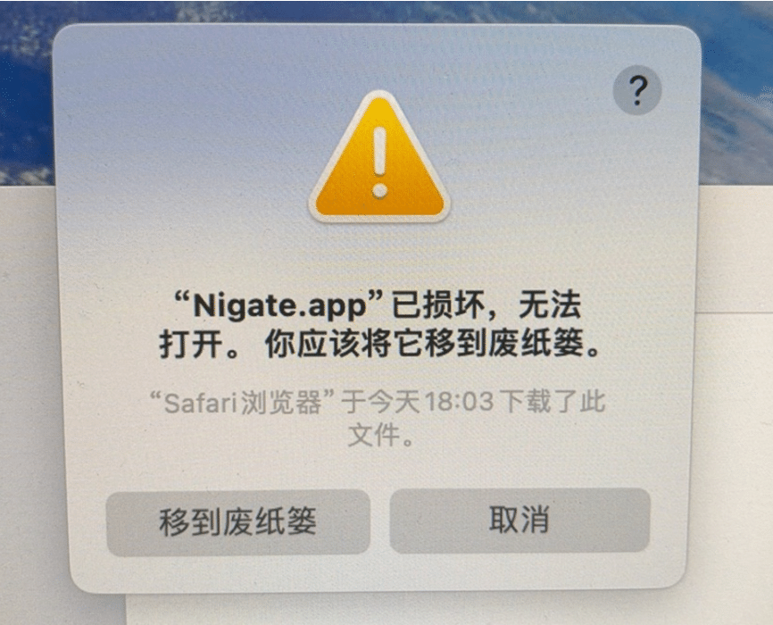

在“App” -> “终端”使用该指令解除：

```bash
xattr -cr /Applications/nigate.app
```


如图操作

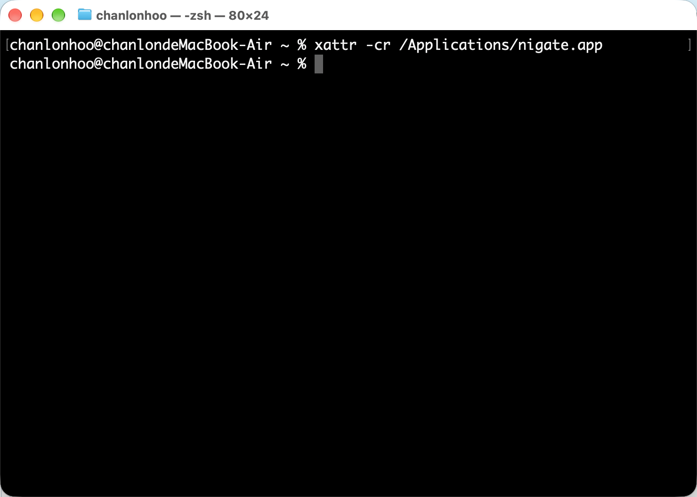

#### 允许任何来源

全局关闭 Gatekeeper，运行如下代码

```bash
sudo spctl --master-disable
```

出现 `Globally disabling the assessment system needs to be confirmed in System Settings.` 提示后，如图操作

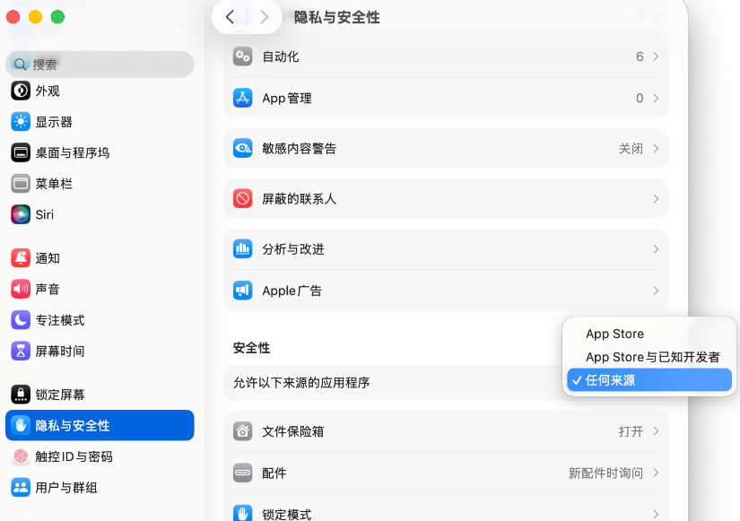

#### 小结

`xattr -cr`：局部放行，精准安全，只解决眼前这个 App 的问题。（⭐⭐⭐⭐⭐ 首选）

`spctl --master-disable`：全局关闭，风险极高，相当于把 Mac 的安全大门彻底敞开。（⭐⭐⭐ 不推荐，但适合IT专业用户）

### 允许第三方内核扩展加载

出现 System Extension Blocked 弹窗时，打开系统设置的“隐私与安全性”，允许“Benjamin Fleischer”的系统扩展。

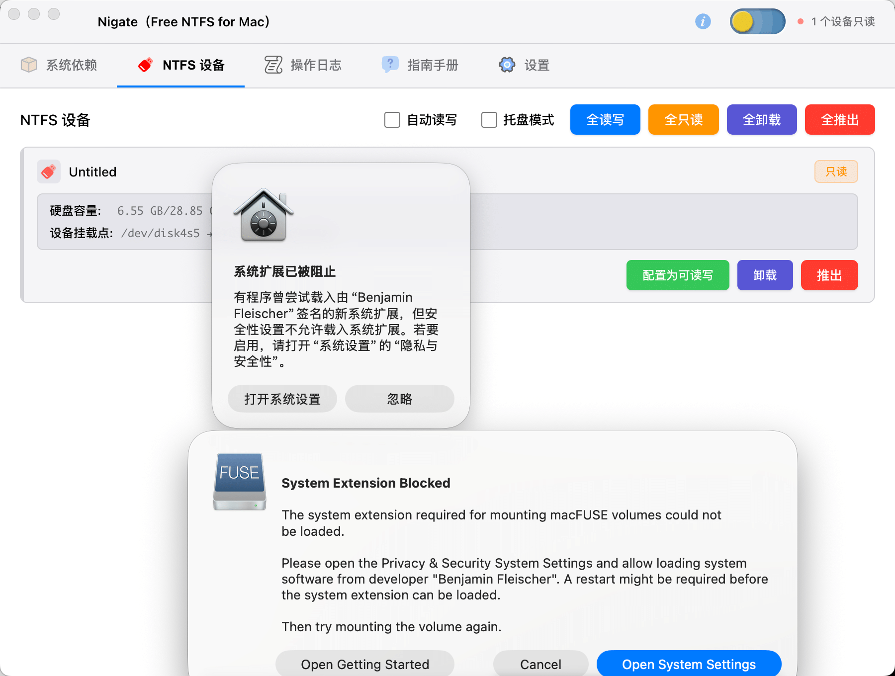

在隐私与安全性中的安全性区域点击启用系统扩展

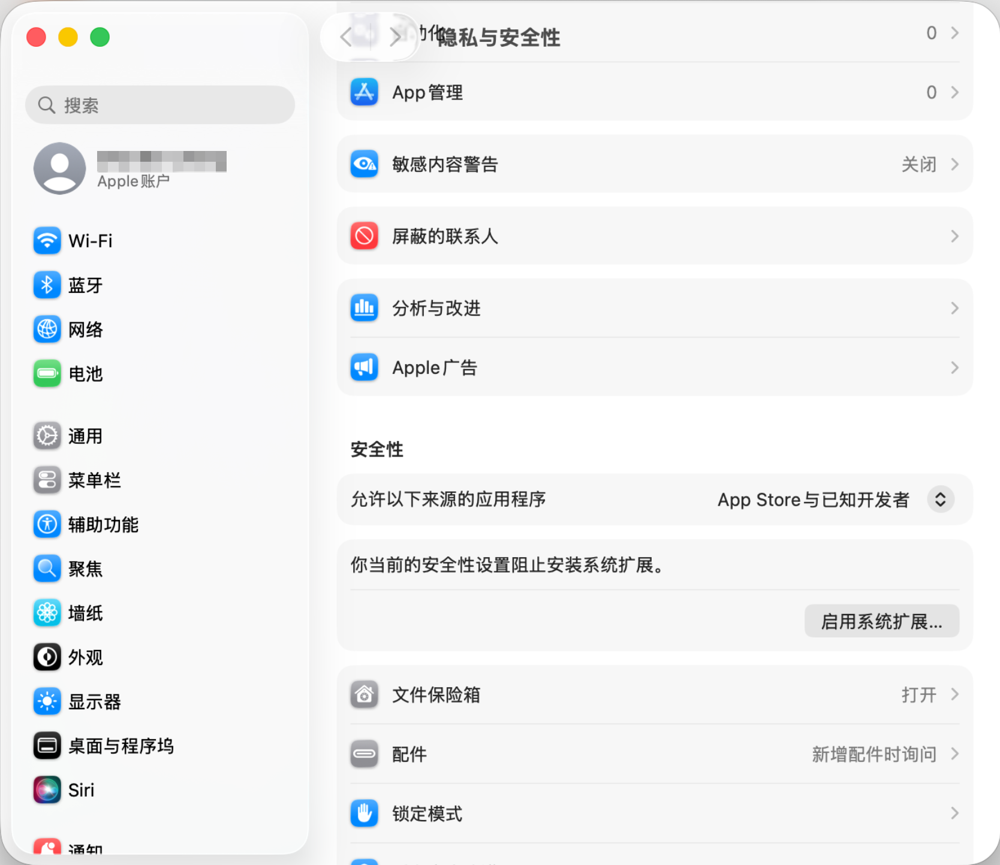

提示关机并进入恢复模式, 点击关机，接着进入到关闭SIP操作内容。

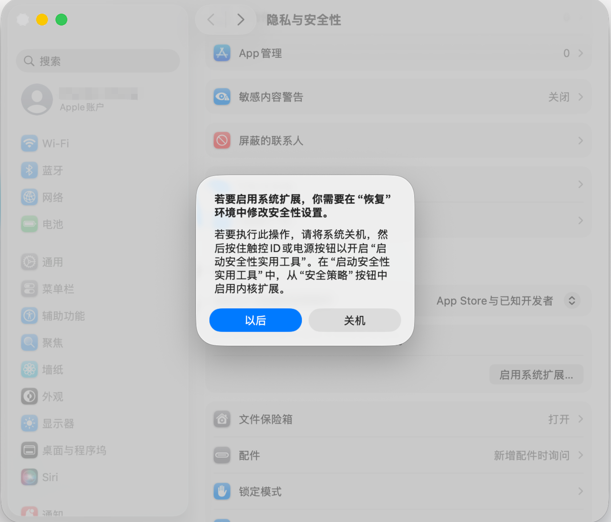

### 关闭SIP

SIP 是 System Integrity Protection 的简写，译为系统完整性保护。目的是为了限制 root 账户对系统的完全控制权，也叫 Rootless 保护机制。Mac 系统中 SIP 状态默认是开启的。 如图，该情况显然是开启的。


关机后，按住电源键不放，直到出现正在载入启动选项。

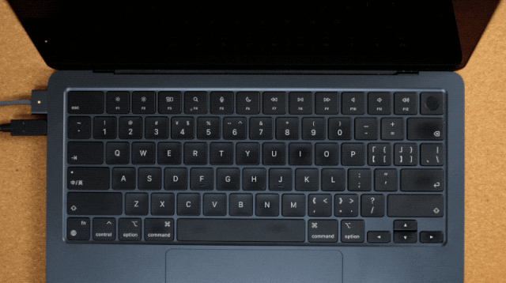

当前要继续保持按住电源按钮


此时可以松开电源按钮了


选择账户，然后点击"下一步"，再输入Mac电脑密码。

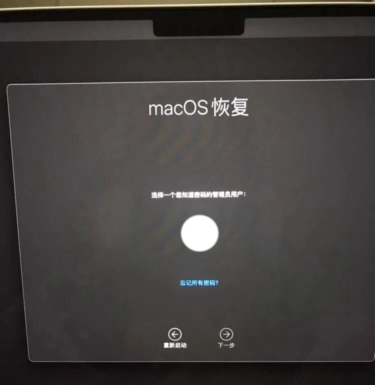

点击选项然后继续。

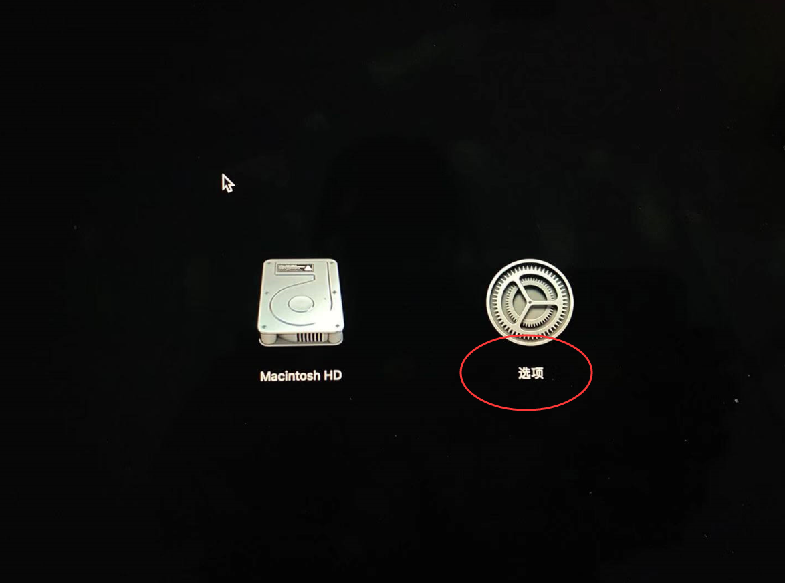

在上方菜单栏选择实用工具 -> 选择启动安全性实用工具

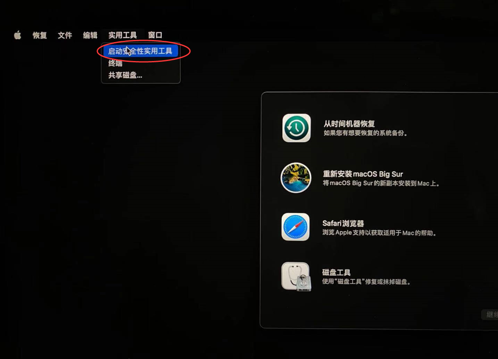

或者选择终端输入 `csrutil disable` 直接结束，重启电脑（此为，方式二）

我们继续方式一，点击安全策略

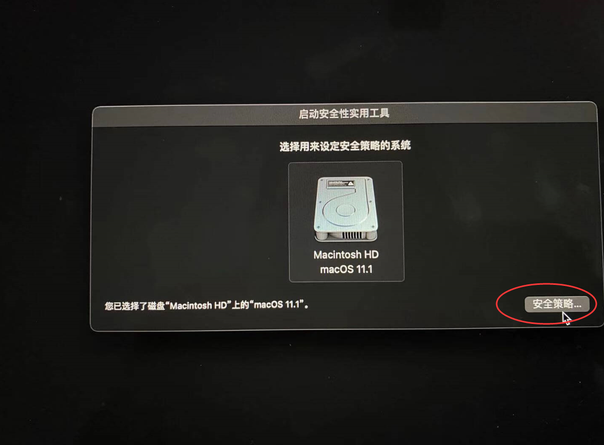

将安全策略设置为降低安全性，并勾选允许用户管理来自被认可开发者的内核扩展→ 确定。

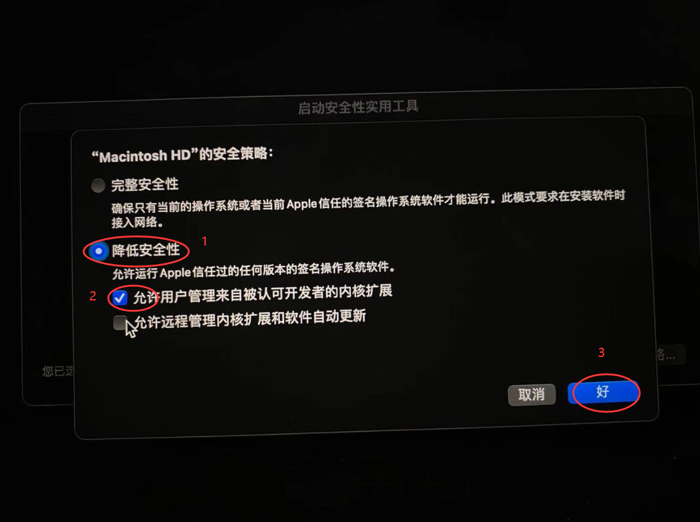

终端输入 `csrutil status` 即可看到 SIP 的状态是 disable 还是 enable 。

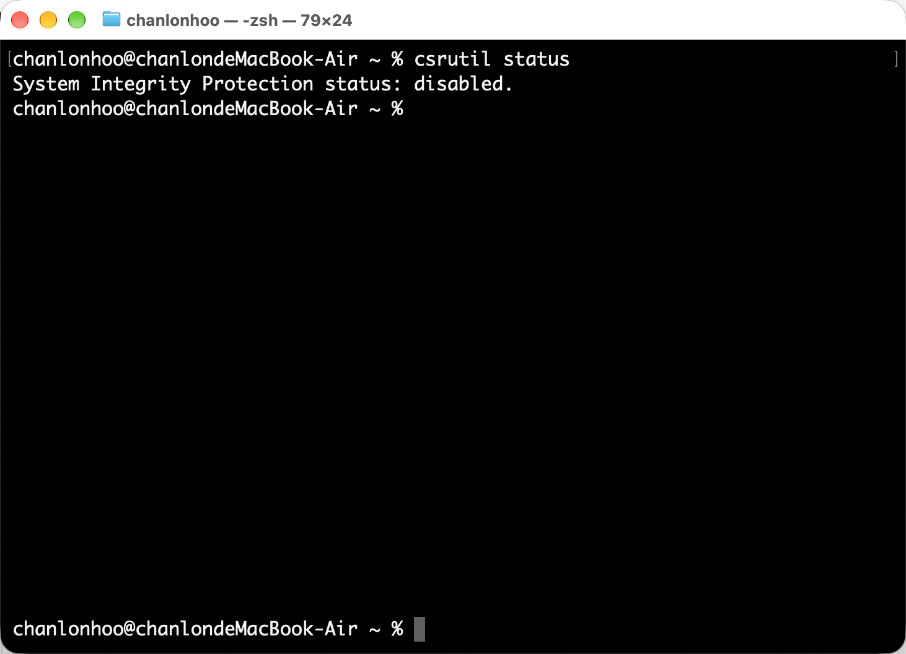

### 开启文件系统扩展

在“通用”设置中，依次选择“登录项与扩展” > “扩展” > “按类别” > “文件系统扩展”。随后点击该项对应的信息图标，或使用如下命令跳转到“文件系统扩展”，并启用 ntfs-3g（如存在）及 macFUSE 等相关选项。

```shell
open "x-apple.systempreferences:com.apple.ExtensionsPreferences?extensionPointIdentifier=com.apple.fskit.fsmodule"
```

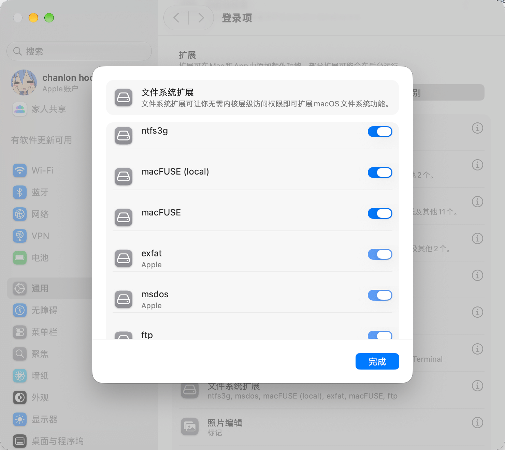

## 设备列表与操作

插入 NTFS 存储设备后，应用会扫描并在“NTFS 设备”页显示已识别的分区。设备卡片显示卷标、设备标识、挂载点和可用/总容量。可用“刷新”重新扫描；顶部批量操作可对符合条件的设备执行挂载、恢复只读、卸载或推出。

### 图标说明

- **页面导航**：拼图表示“依赖”，磁盘表示“NTFS 设备”，问号表示“帮助”，齿轮表示“设置”。
- **顶部工具栏**：咖啡杯切换防止休眠模式；盾牌长按 3 秒切换状态保护；电源用于退出，爱心打开“支持作者”，信息图标打开“关于”，太阳/月亮切换外观。
- **状态圆点**：绿色表示已识别设备且没有只读卷；橙色表示缺少核心依赖或存在只读卷；灰色表示尚未识别到 NTFS 设备。
- **设备操作**：圆形箭头表示刷新；铅笔表示读写挂载；眼睛表示恢复只读；弹出符号表示卸载；带叉磁盘表示推出；扳手与螺丝刀表示修复；文本光标表示重命名；内置磁盘表示格式化；回转箭头表示重置。设备卡片的磁盘图标为绿色表示读写、橙色表示只读；操作图标旁也会显示文字名称。

- **只读**：只能读取文件，不能写入。Windows 快速启动或休眠可能使文件系统处于不安全状态；遇到此情况，请在 Windows 中完整关机后再连接到 Mac。
- **读写挂载**：点击“读写”并按提示授权管理员操作。它会先卸载现有挂载，再由 `ntfs-3g` 以读写模式挂载。若卷正在使用，先关闭正在访问它的应用。
- **恢复只读**：卸载读写挂载，再交由 macOS 以只读方式重新挂载。手动选择会暂时阻止自动读写再次改动该卷。
- **卸载**：移除文件系统挂载，设备仍连接在 Mac 上。之后可刷新设备列表并重新挂载。
- **推出**：请求 macOS 完全推出设备。只有系统操作成功后才算完成；完成后可安全拔出。推出前关闭正在访问磁盘的应用。
- **重置**：用于处理设备占用等问题。应用会卸载分区、运行 `ntfsfix`，然后尝试以只读模式重新挂载；需要管理员授权，修复仍有数据风险。
- **修复**：运行 `ntfsfix` 处理有限的文件系统问题，之后尝试恢复设备原来的挂载模式。失败时请记录错误信息，不要反复对重要数据尝试修复。
- **重命名**：输入新的卷标后，应用会卸载设备、更新 NTFS 卷标及分区名称，再恢复原来的只读或读写挂载方式。名称不能为空、最多 32 个字符，且不能包含 `\\ / : * ? " < > |`。操作期间不要传输文件。

### 卸载与推出

| 操作 | 文件系统挂载 | 设备连接 | 后续使用 |
| --- | --- | --- | --- |
| 卸载 | 移除挂载 | 保持连接 | 刷新后可再次挂载 |
| 推出 | 随设备推出 | 请求系统断开 | 重新连接设备后使用 |

“卸载”不等同于安全拔出；准备拔出设备时应使用“推出”，并等待系统确认完成。

## 格式化

格式化会清除整块磁盘上的所有分区和数据，无法撤销。应用会将整块磁盘重建为 GPT 分区表和 NTFS 文件系统，而不只是清空当前分区。请先备份，并确认目标磁盘及其容量。

出于安全考虑，只有 macOS 明确确认目标为外置物理整盘、不是启动盘、不是内置盘/虚拟盘/磁盘映像/合成设备，且设备标识、分区、协议等信息一致时，才允许格式化。信息缺失、未知或矛盾都会拒绝操作。格式化期间不要拔盘、关机或强制退出应用。

## 自动读写

应用会在扫描时处理**已挂载且当前为只读**的 NTFS 卷，自动改挂为读写。窗口不必打开。未挂载、已读写或无法识别的设备不会作为候选项。自动挂载需要管理员授权；遇到密码提示时按系统账户密码完成授权。

手动恢复只读或使用“重置”后，当前连接中的设备会被记为手动只读，不会立刻改回读写。之后手动执行读写挂载会清除此选择。

## 防止休眠与状态保护

点击标题栏咖啡杯图标可在 **关闭 → 防止休眠 → 智能防止休眠 → 关闭** 之间切换。默认为智能防止休眠。状态保护开启时，该图标会被锁定。

- **关闭**：应用不阻止系统休眠。
- **防止休眠**：持续阻止空闲休眠，适合长时间任务；设备空闲时也会保持开启。
- **智能防止休眠**：只监视已挂载的磁盘。检测到磁盘读写活动时阻止休眠，活动停止约 20 秒后恢复允许休眠；没有已挂载磁盘时不会持续阻止休眠。

退出应用会停止防止休眠。长按标题栏盾牌图标 3 秒可开启或解除状态保护；它用于避免误触，不会保护磁盘免受故障或数据丢失。

## 设置

“设置”页可配置管理员密码是否保存到 macOS Keychain、登录时启动、启动时默认页、界面语言、主题，以及是否显示按钮悬停提示。悬停提示默认关闭。只有启用密码保存时，管理员密码才会写入 Keychain；可随时关闭此选项或删除已保存密码。

关闭窗口时应用会留在菜单栏，不会退出。可通过菜单栏图标打开主窗口或管理 NTFS 设备。语言或主题设置会自动保存。防止休眠也可从标题栏开关控制。

## 常见问题与排查

### 为什么设备是只读？

macOS 默认以只读方式挂载 NTFS。确认依赖页中的 MacFUSE 与 `ntfs-3g` 已就绪，再点击“读写”。若 Windows 曾启用快速启动或休眠，请将磁盘接回 Windows 并完整关机后再试。

### 挂载失败或超时怎么办？

先在“依赖”页重新检查依赖，确认设备没有被其他应用占用，并检查管理员授权是否成功。Windows 未完整关机也可能导致文件系统不一致。超时后请先刷新设备列表；不要在仍有文件传输时反复重试。

### 出现 `Resource busy` 怎么办？

先关闭 Finder 窗口及正在访问该卷的应用，再使用设备卡片上的“重置”。该操作会卸载分区、运行 `ntfsfix` 并尝试只读重挂载，需要管理员授权。重要数据应先备份；如果仍失败，记下错误并寻求支持，不要直接对不确定的磁盘标识运行破坏性终端命令。

### 修复后仍无法读写？

`ntfsfix` 的修复范围有限，可能只修复部分元数据。请在 Windows 中运行管理员权限的 `chkdsk` 检查磁盘；重要数据无法访问时，先停止写入并优先恢复数据。

### MacFUSE 在 macOS 更新后提示版本过旧或扩展被阻止？

在“依赖”页展开 MacFUSE，按页面给出的升级步骤更新官方版本，并在“系统设置 → 隐私与安全性”中批准经确认的扩展。不同 macOS 版本的设置名称可能不同。不要为了安装而长期关闭 Gatekeeper；如流程要求临时调整系统安全设置，请遵照页面警告并在完成后立即恢复。Apple 芯片若仍无法加载内核扩展，见上文「关闭SIP」。

### 卸载后在哪里找到设备？

卸载只解除文件系统挂载，设备仍连接着。刷新设备列表后可重新挂载；准备拔出时使用“推出”。

更多故障排查请查看[疑难解答中心](https://github.com/hoochanlon/Free-NTFS-for-Mac/issues/9)。如需报告问题，请附上 macOS 版本、设备信息、执行的操作和完整错误提示，并避免公开密码或个人文件内容。
